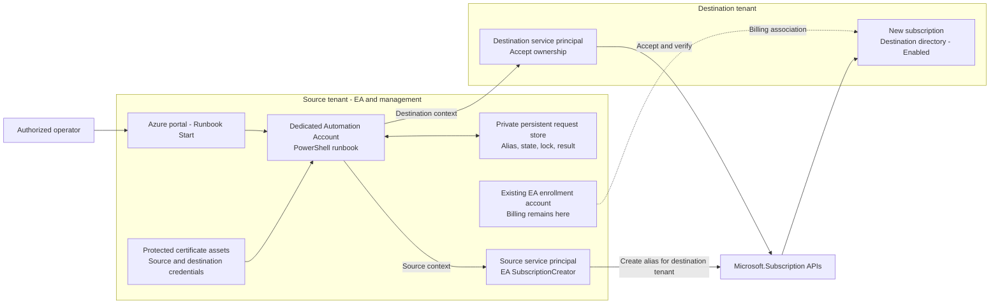

# EA Cross-Tenant Subscription Automation

Create a new Azure subscription in a destination Microsoft Entra tenant, billed to an existing Enterprise Agreement (EA) enrollment account. The engine specifies the destination tenant during creation, accepts ownership there, and verifies the subscription is `Enabled`.

**Available:** PowerShell engine, local certificate-authentication launcher, and mocked tests. **To implement:** Automation runbook adapter, infrastructure, persistent request state, locks, and scheduled reconciliation. Parsing and static checks passed; Pester discovery was blocked by unsigned-script policy. Live authentication and subscription creation require acceptance testing.

## Architecture



In the target architecture, an operator enters the subscription name and stable alias in the Azure portal and selects **Start**. A dedicated Automation Account in an existing source-tenant management subscription executes the runbook using two protected application credentials.

| Component | Responsibility |
| --- | --- |
| Source principal | Application registered in its home tenant; EA billing `SubscriptionCreator` on the selected enrollment account. Role ID: `a0bcee42-bf30-4d1b-926a-48d21664ef71`. |
| Destination principal | Authenticates in the final tenant and becomes subscription Owner. Use its Enterprise application Object ID as `TargetOwnerObjectId`. |
| Certificate assets | Store both private-key certificates; register the corresponding public certificates on the applications. |
| Request store | Persist alias, parameters, request fingerprint, subscription ID, progress, lock, and outcome. |
| Operator | Starts approved jobs and reads results. Keep code and credential administration separate. |

## Execution Flow

1. Validate certificates, identities, and fixed tenant/billing configuration.
2. Submit the EA alias request with `subscriptionTenantId` and `subscriptionOwnerId`.
3. Wait for the subscription ID, accept ownership using the destination context, and poll completion.
4. Read the subscription and verify its ID, tenant, and `Enabled` state.

The cloud adapter must wrap this engine with per-alias locking, durable request records, and scheduled recovery. Until then, operators must enforce a single execution per alias. Team access to the resulting subscription requires a separate role assignment.

## Security

- Retrieve certificates inside the approved runbook. Keep keys and tokens out of Git, job parameters, and logs; assign owners for renewal and expiry monitoring.
- Limit operator permissions to required job actions. Runbook editors can use its credentials: treat code modification as privileged access.
- Use explicit source/destination contexts with context autosave disabled. Test isolation between concurrent Automation jobs.
- Use the Automation managed identity for authorized local Storage or Key Vault access. Keep both application identities for the subscription operations.
- Protect request records with least-privilege access and retention controls. For network-restricted Storage or Key Vault, validate a Hybrid Runbook Worker and its network path; cloud sandboxes are excluded from the trusted-services firewall exception.
- Publish an approved, versioned runbook artifact and use authenticated portal access.

## Reliability and Recovery

Keep the same alias and parameters after a timeout or interrupted write: Azure may already have accepted the operation. Inspect with `Verify`, then continue an existing request with `Resume`. An absent/unreadable alias or `403` requires diagnosis before another write. Cancellation is a separate administrative operation.

| Mode | Engine behavior |
| --- | --- |
| `Validate` | Identity checks and read-only API calls. Default for direct engine invocation. Creation permission requires separate EA role verification. |
| `CreateAndAccept` | Creates a new request and accepts ownership. Default for the local OneTouch launcher. |
| `Verify` | Read-only inspection of an existing request. |
| `Resume` | Continues an existing alias; creation PUT is disabled. |

The cloud adapter must survive job interruption and the sandbox's three-hour runtime limit. Persist progress outside the job and require final subscription verification before recording success.

## Repository Contents

| File | Purpose |
| --- | --- |
| [New-EASubscriptionCrossTenant.v2.ps1](New-EASubscriptionCrossTenant.v2.ps1) | Current execution engine; accepts preauthenticated source/destination contexts. |
| [New-EASubscriptionCrossTenant.OneTouch.ps1](New-EASubscriptionCrossTenant.OneTouch.ps1) | Local Windows launcher using `Cert:\CurrentUser\My`. |
| [New-EASubscriptionCrossTenant.v2.Tests.ps1](New-EASubscriptionCrossTenant.v2.Tests.ps1) | Mocked Pester tests for the engine and local launcher. |
| [TESTING-AND-EVIDENCE.md](TESTING-AND-EVIDENCE.md) | Prerequisites, invocation examples, recovery, evidence, and official references. |
| [RECOMMENDED-APPROACH.md](RECOMMENDED-APPROACH.md) | Local pilot setup and implementation decisions. |
| [New-EASubscriptionCrossTenant.ps1](New-EASubscriptionCrossTenant.ps1) | Historical v1 example, retained for comparison; use v2 for new work. |

## Local Evaluation

Use a dedicated Windows PowerShell 7.2+ session, `Az.Accounts` 5.3.1+, Pester 5, and approved script execution/signing policy. Follow [TESTING-AND-EVIDENCE.md](TESTING-AND-EVIDENCE.md) for setup and invocation: offline `WhatIf`, read-only `Validate`, then an approved `CreateAndAccept` run. Creation produces a real, billable subscription.

```powershell
Invoke-Pester -Path ./New-EASubscriptionCrossTenant.v2.Tests.ps1 -Output Detailed
```

Acceptance requires passing offline tests with nonzero execution, runtime authentication/recovery/concurrency checks, and one approved real creation. Independently verify destination IAM and source EA billing in addition to the engine's final subscription read. Retain results and the exact artifact version.

## Official References

- [Programmatic EA subscription creation and cross-tenant acceptance](https://learn.microsoft.com/azure/cost-management-billing/manage/programmatically-create-subscription-enterprise-agreement)
- [EA billing roles for service principals](https://learn.microsoft.com/azure/cost-management-billing/manage/assign-roles-azure-service-principals)
- [Alias creation API](https://learn.microsoft.com/rest/api/subscription/alias/create?view=rest-subscription-2021-10-01)
- [Ownership acceptance API](https://learn.microsoft.com/rest/api/subscription/subscription/accept-ownership?view=rest-subscription-2021-10-01)
- [Azure Automation certificate assets](https://learn.microsoft.com/azure/automation/shared-resources/certificates)
- [Azure Automation role-based access control](https://learn.microsoft.com/azure/automation/automation-role-based-access-control)
- [Azure Automation runbook execution and limits](https://learn.microsoft.com/azure/automation/automation-runbook-execution)
