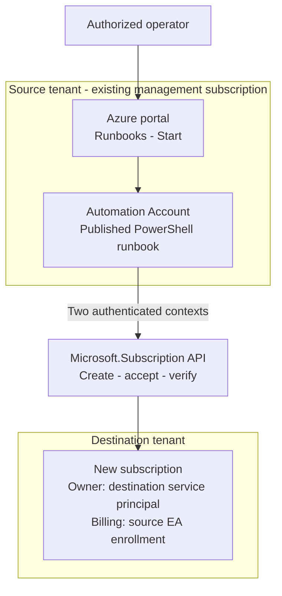

# EA Cross-Tenant Subscription Automation

Create a new Azure subscription in a destination Microsoft Entra tenant, billed to an existing Enterprise Agreement (EA) enrollment account. The engine specifies the destination tenant during creation, accepts ownership there, and verifies the subscription is `Enabled`.

**Included:** Bicep infrastructure, native Automation runbook, build/publish utility, execution engine, and mocked tests. Follow [DEPLOYMENT.md](DEPLOYMENT.md) for setup. The validation workflow compiles Bicep and runs offline tests; live authentication and subscription creation require acceptance testing.

## Architecture



Use the native Azure portal: **Automation Account → Runbooks → Start**. The operator fills in the runbook parameters and follows the job output. The runbook performs creation, acceptance, and verification in one execution.

### Components

| Component | Location and purpose |
| --- | --- |
| Automation Account | One account in an existing source-tenant management subscription. Hosts the runbook, PowerShell runtime, configuration, certificate assets, and job history. |
| PowerShell runbook | Published executable code inside the Automation Account. Retrieves credentials, authenticates both principals, and invokes the v2 engine. |
| Two certificate assets | Protected assets inside the Automation Account, one for each application. Hold private keys; matching public certificates are registered on the applications. |
| Source service principal | Application identity in the source tenant. Creates subscriptions under the selected EA enrollment account using billing role `SubscriptionCreator`, ID `a0bcee42-bf30-4d1b-926a-48d21664ef71`. |
| Destination service principal | Application identity in the destination tenant. Accepts ownership and becomes Owner of the new subscription. Its Enterprise application Object ID is `TargetOwnerObjectId`. |
| EA enrollment account | Existing billing scope in the source environment. Pays for the new subscription after creation and acceptance. |
| Request storage | One Azure Storage account with an authenticated Blob container. Stores request parameters, hash, execution state, and final result. An infinite-duration blob lease locks each alias until the job releases it. |
| Automation managed identity | Authenticates access to request storage. Grant only the required storage data permissions at container scope. |

The two service principals supply authorization; the certificates authenticate them. Automation job history shows execution output, while request storage retains recovery state across jobs. The cloud sandbox accesses Storage over its public HTTPS endpoint using Entra/RBAC; anonymous access and shared keys are disabled.

### Native Start Form

| Operator input | Purpose |
| --- | --- |
| `SubscriptionName` | Display name of the new subscription. |
| `AliasName` | Stable request identifier, retained for verification and recovery. |
| `Workload` | `Production` or an enabled `DevTest` offer. |
| `Mode` | `Validate` (cloud default), `CreateAndAccept`, `Verify`, or `Resume`. |

Administrators fix tenant IDs, application IDs, destination owner ID, certificate asset names, and the approved EA enrollment in Automation configuration. Operators receive permission to start jobs and read results; maintainers control code and credentials.

## Execution Flow

1. Validate certificates, identities, and fixed tenant/billing configuration.
2. Submit the EA alias request with `subscriptionTenantId` and `subscriptionOwnerId`.
3. Wait for the subscription ID, accept ownership using the destination context, and poll completion.
4. Read the subscription and verify its ID, tenant, and `Enabled` state.

The runbook locks the request before subscription writes and saves its outcome. `Validate` and `Verify` use read-only requests. Operators inspect and recover unfinished requests through the same Start form. Team access to the resulting subscription requires a separate role assignment.

## Security

- Retrieve certificates inside the approved runbook. Keep keys and tokens out of Git, job parameters, and logs; assign owners for renewal and expiry monitoring.
- Limit operator permissions to required job actions. Runbook editors can use its credentials: treat code modification as privileged access.
- Use explicit source/destination contexts with context autosave disabled. Test isolation between concurrent Automation jobs.
- Use the Automation managed identity for authorized local Storage or Key Vault access. Keep both application identities for the subscription operations.
- Protect request records with least-privilege access and retention controls. For network-restricted Storage or Key Vault, validate a Hybrid Runbook Worker and its network path; cloud sandboxes are excluded from the trusted-services firewall exception.
- Publish an approved, versioned runbook artifact and use authenticated portal access.

## Reliability and Recovery

Keep the same alias and parameters after a timeout or interrupted write: Azure may already have accepted the operation. Inspect with `Verify`, then continue an existing request with `Resume`. An absent/unreadable alias or `403` requires diagnosis before another write. Cancellation is a separate administrative operation.

| Mode | Engine behavior |
| --- | --- |
| `Validate` | Identity checks and read-only API calls. Default for direct engine invocation. Creation permission requires separate EA role verification. |
| `CreateAndAccept` | Creates a new request and accepts ownership. Default for the local OneTouch launcher. |
| `Verify` | Read-only inspection of an existing request. |
| `Resume` | Continues an existing alias; creation PUT is disabled. |

An interrupted job can leave its infinite-duration lease held. Run `Verify`, stop all jobs for that alias, and have a storage administrator release the lease through **Break lease** in the Azure portal. Review the remote operation before selecting `Resume`. A `NeedsReview` record prevents creation replay. See [DEPLOYMENT.md](DEPLOYMENT.md) for the recovery procedure.

## Repository Contents

| File | Purpose |
| --- | --- |
| [infra/main.bicep](infra/main.bicep) | Automation Account, PowerShell 7.4 runtime, storage, container-scoped RBAC, configuration, and runbook draft. |
| [infra/main.bicepparam](infra/main.bicepparam) | Synthetic deployment parameter example. |
| [automation/Runbook.template.ps1](automation/Runbook.template.ps1) | Cloud authentication, request records, and locking; built with the engine before publication. |
| [Publish-EAAutomationRunbook.ps1](Publish-EAAutomationRunbook.ps1) | Builds the standalone artifact; optionally uploads, publishes, and verifies its content. |
| [New-EASubscriptionCrossTenant.v2.ps1](New-EASubscriptionCrossTenant.v2.ps1) | Current execution engine; accepts preauthenticated source/destination contexts. |
| [New-EASubscriptionCrossTenant.OneTouch.ps1](New-EASubscriptionCrossTenant.OneTouch.ps1) | Local Windows launcher for pilot testing using `Cert:\CurrentUser\My`. |
| [New-EASubscriptionCrossTenant.v2.Tests.ps1](New-EASubscriptionCrossTenant.v2.Tests.ps1) | Engine, local launcher, cloud artifact, and compiled infrastructure tests. |
| [DEPLOYMENT.md](DEPLOYMENT.md) | Infrastructure deployment, certificate setup, publication, native Start form, and recovery. |
| [TESTING-AND-EVIDENCE.md](TESTING-AND-EVIDENCE.md) | Prerequisites, invocation examples, recovery, evidence, and official references. |
| [RECOMMENDED-APPROACH.md](RECOMMENDED-APPROACH.md) | Local pilot setup and implementation decisions. |

## Local Evaluation

Use a dedicated Windows PowerShell 7.2+ session, `Az.Accounts` 5.3.1+, Pester 5, and approved script execution/signing policy. Follow [TESTING-AND-EVIDENCE.md](TESTING-AND-EVIDENCE.md) for setup and invocation: offline `WhatIf`, read-only `Validate`, then an approved `CreateAndAccept` run. Creation produces a real, billable subscription.

```powershell
bicep build infra/main.bicep --outfile build/main.json
Invoke-Pester -Path ./New-EASubscriptionCrossTenant.v2.Tests.ps1 -Output Detailed
```

Acceptance requires passing offline tests with nonzero execution, runtime authentication/recovery/concurrency checks, and one approved real creation. Independently verify destination IAM and source EA billing in addition to the engine's final subscription read. Retain results and the exact artifact version.

## Official References

- [Programmatic EA subscription creation and cross-tenant acceptance](https://learn.microsoft.com/azure/cost-management-billing/manage/programmatically-create-subscription-enterprise-agreement)
- [EA billing roles for service principals](https://learn.microsoft.com/azure/cost-management-billing/manage/assign-roles-azure-service-principals)
- [Alias creation API](https://learn.microsoft.com/rest/api/subscription/alias/create?view=rest-subscription-2021-10-01)
- [Ownership acceptance API](https://learn.microsoft.com/rest/api/subscription/subscription/accept-ownership?view=rest-subscription-2021-10-01)
- [Azure Automation certificate assets](https://learn.microsoft.com/azure/automation/shared-resources/certificates)
- [Azure Automation role-based access control](https://learn.microsoft.com/azure/automation/automation-role-based-access-control)
- [Azure Automation runbook execution and limits](https://learn.microsoft.com/azure/automation/automation-runbook-execution)
