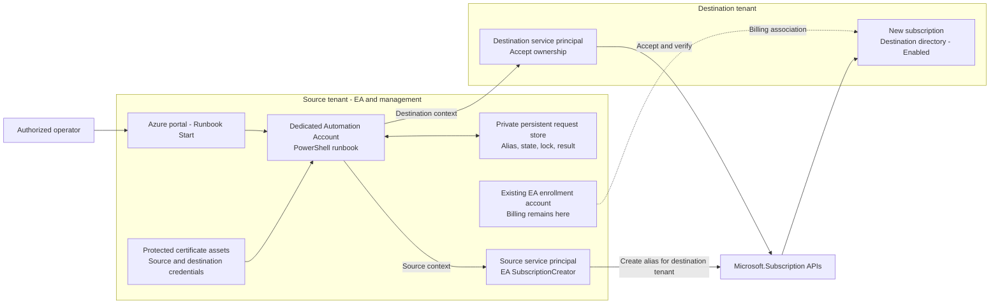

# EA Cross-Tenant Subscription Automation

Create a new Azure subscription billed to an existing Enterprise Agreement (EA), with its final directory in a different Microsoft Entra tenant. The target operating model is an Azure Automation runbook: an authorized operator supplies a subscription name and stable request alias in the Azure portal and selects **Start**. Protected application credentials perform creation and ownership acceptance without interactive sign-in.

**Status:** reference implementation and architecture proposal, not a deployed or production-certified service. This repository contains the PowerShell execution engine, a local certificate-authentication launcher, and mocked tests. The Automation adapter, infrastructure, persistent request store, distributed locking, and scheduled reconciliation are **not implemented yet**. No Azure resources are created by cloning this repository.

## Objective

- Keep billing on the selected source EA enrollment account.
- End with the new subscription in the destination tenant, in `Enabled` state.
- Automatically accept ownership using a destination-tenant service principal.
- Protect private keys and separate operator access from credential administration.
- Preserve request identity after errors so recovery does not create duplicate billable subscriptions.

"Move to the destination tenant" describes the desired outcome. The implemented API flow specifies `subscriptionTenantId` during creation and then accepts ownership in that tenant. It does **not** first provision a populated subscription in the source tenant and execute Change Directory. Existing resources, RBAC assignments, and managed identities are not migrated; billing ownership is not transferred to another agreement.

## Architecture



The Automation Account is hosted in an **existing management subscription** in the source tenant, not the subscription being created. Hosting in another approved management tenant is a separate design choice. The diagram shows the target architecture, including components not yet supplied as deployable code.

| Component | Responsibility |
| --- | --- |
| Source tenant and EA | Own the selected billing scope and authorize subscription creation. |
| Source service principal | Application registered in its home tenant; EA billing `SubscriptionCreator` on the selected enrollment account only. |
| Destination service principal | Authenticates in the destination tenant; its local Enterprise application Object ID is the requested new Owner. |
| Automation Account | Runs approved code with two explicit, separate authentication contexts. |
| Protected certificate assets | Hold the private-key certificates required to authenticate both principals. Public certificates are registered on the applications. |
| Persistent request store | Retains alias, parameters, request fingerprint, subscription ID, progress, timestamps, lock, and outcome outside the job process. |
| Operator | Starts authorized jobs and reads permitted results without being able to replace code or retrieve credentials. |

The source identity's EA role is a **billing role**, not Azure subscription RBAC. Its role ID is `a0bcee42-bf30-4d1b-926a-48d21664ef71`. An authorized administrator assigns it once. The destination principal does not need preassigned Owner at tenant root or Global Administrator merely to run this flow. It becomes Owner of the new subscription; the operator does not automatically receive subscription access.

Two separate applications are the baseline for clarity and credential isolation, not a universal Azure requirement. The operator's presence as a guest does not make the guest the subscription creator: the backend uses application identities.

## Execution Flow

1. The operator starts the published runbook with `SubscriptionName`, `AliasName`, `Workload`, and an explicit operation mode. Tenant IDs, application IDs, certificate asset names, and the approved enrollment are administrator-controlled configuration, not arbitrary operator choices.
2. The runbook acquires a per-alias lock and records the immutable request. Both certificates and sign-ins are validated before any subscription write. Configuration mismatches or identity failures stop execution.
3. With the source context, the engine checks the alias and submits `PUT /providers/Microsoft.Subscription/aliases/{alias}` with the EA billing scope, destination tenant ID, and destination owner Object ID.
4. It waits for the subscription ID and readable destination ownership status. With the destination context, it sends `acceptOwnership` only when acceptance is required.
5. It waits for completion, then reads the actual subscription and checks its ID, tenant, and `Enabled` state. HTTP `202 Accepted` alone is not success.
6. The runbook persists the outcome and releases its lock. An authorized reconciliation job inspects unfinished requests and resumes existing aliases without repeating creation.

Steps involving persistent state, locking, and reconciliation are requirements for the cloud adapter, **not features of the current scripts**. The engine already implements identity checks, polling, `Verify`, and `Resume`; callers must currently prevent concurrent runs themselves.

## Credential and Access Protection

- Store private keys in protected Automation certificate assets, never in Git, job parameters, plain configuration files, or output streams. Certificate retrieval belongs inside the approved runbook. Validate the chosen runtime's certificate-authentication path during acceptance testing.
- Use separate source and destination credentials; control renewal, expiry monitoring, and administrative access. Only public certificates are uploaded to app registrations.
- Restrict operator permissions to the required runbook/job actions. A person who can edit executable runbook code can use its credentials; granting broad Automation Contributor access is not credential isolation. Verify the selected role's actual actions and scopes.
- Use the Automation managed identity for local storage or Key Vault access where appropriate. Do not assume it replaces the EA source principal or automatically obtains destination-tenant tokens.
- Disable context autosave and pass explicit contexts to token/API calls. Shared Automation processes make default-context assumptions unsafe; test concurrent jobs as part of runtime validation.
- Keep the request store private with least-privilege access and retention controls. IDs and aliases are nonsecret but can still be organizational metadata.
- Match storage/Key Vault networking to the execution environment. A cloud sandbox cannot reach those services merely because their firewall allows trusted Microsoft services. If private networking is mandatory, design and validate a Hybrid Runbook Worker with the required network path; "private request store" does not imply sandbox support for private endpoints.
- Do not expose an anonymous/shared-secret webhook as the operator entry point. Avoid credential/token logging and enforce an approved signing and publishing process.

## Reliability and Recovery

One stable alias identifies one request. A display name is not an idempotency key. Never change the alias to retry an uncertain write: Azure may already have created a billable subscription.

| Mode | Engine behavior |
| --- | --- |
| `Validate` | Identity checks and read-only API calls; does not prove creation permission. Default for direct engine invocation. |
| `CreateAndAccept` | Creates a new request and accepts ownership. Default for the local OneTouch launcher. |
| `Verify` | Reads an existing request without accepting ownership. |
| `Resume` | Continues an existing alias; never performs creation PUT. |

After a timeout or interrupted write, inspect with `Verify`, then use `Resume` when appropriate. An absent or unreadable alias after an uncertain error requires diagnosis, not automatic recreation. `403` is not treated as `404`. There is no transactional rollback or automatic subscription cancellation.

Automation job completion is not evidence that a remote operation completed. Cloud sandbox jobs have runtime limits; retain state outside the process and reconcile separately. The native Start form is intentionally simple, not a rich provisioning portal. Persistent locks must prevent simultaneous execution for the same alias and handle expiry without enabling concurrent replay of uncertain writes.

## Repository Contents

| File | Purpose |
| --- | --- |
| [New-EASubscriptionCrossTenant.v2.ps1](New-EASubscriptionCrossTenant.v2.ps1) | Current execution engine; accepts preauthenticated source/destination contexts. |
| [New-EASubscriptionCrossTenant.OneTouch.ps1](New-EASubscriptionCrossTenant.OneTouch.ps1) | Local Windows launcher using `Cert:\CurrentUser\My`; not an Automation runbook. |
| [New-EASubscriptionCrossTenant.v2.Tests.ps1](New-EASubscriptionCrossTenant.v2.Tests.ps1) | Mocked Pester tests for the engine and local launcher. |
| [TESTING-AND-EVIDENCE.md](TESTING-AND-EVIDENCE.md) | Prerequisites, invocation examples, recovery, evidence, and official references. |
| [RECOMMENDED-APPROACH.md](RECOMMENDED-APPROACH.md) | Earlier local-launcher proposal; this README supersedes its hosting recommendation. |
| [New-EASubscriptionCrossTenant.ps1](New-EASubscriptionCrossTenant.ps1) | Historical v1 example, retained for comparison; use v2 for new work. |

All documentation, comments, and operator-facing messages are in English. Configuration examples use placeholders; no certificates or tenant credentials belong in the repository.

## Local Evaluation

Use a dedicated Windows PowerShell 7.2+ session with `Az.Accounts` 5.3.1+ for the local launcher and Pester 5 for tests. Follow organizational execution/signing policy; do not bypass it merely to run these files.

Follow [TESTING-AND-EVIDENCE.md](TESTING-AND-EVIDENCE.md) to configure the two principals and run offline `WhatIf`, then read-only `Validate`. `WhatIf` does not contact Azure. Only an explicitly approved `CreateAndAccept` run should create a real subscription. There is no sandbox mode for subscription creation.

```powershell
Invoke-Pester -Path ./New-EASubscriptionCrossTenant.v2.Tests.ps1 -Output Detailed
```

Parsing/static checks have passed. Previous Pester execution was blocked during discovery by policy for unsigned files; no passing runtime test or live Azure acceptance result is claimed. Neither local sign-in nor subscription creation has been verified against the customer environment.

## Automation Implementation Gate

Before deploying this design, implement and review the cloud adapter: select a supported PowerShell runtime, package the v2 engine with the runbook, retrieve protected certificate assets, enforce fixed tenant/billing configuration, and implement durable request state, per-alias locks, and scheduled read/resume reconciliation. Do not download mutable scripts from a branch at job startup; publish an approved, versioned artifact.

Acceptance requires nonzero passing offline tests, runtime authentication tests, recovery and concurrency tests, one approved real creation, and independent verification of destination IAM and source EA billing. `RequestedBillingScope` output records the requested scope; it is not independent proof of the billing association. Assigning user/group access or moving existing workloads is a separate extension.

## Official References

- [Programmatic EA subscription creation and cross-tenant acceptance](https://learn.microsoft.com/azure/cost-management-billing/manage/programmatically-create-subscription-enterprise-agreement)
- [EA billing roles for service principals](https://learn.microsoft.com/azure/cost-management-billing/manage/assign-roles-azure-service-principals)
- [Alias creation API](https://learn.microsoft.com/rest/api/subscription/alias/create?view=rest-subscription-2021-10-01)
- [Ownership acceptance API](https://learn.microsoft.com/rest/api/subscription/subscription/accept-ownership?view=rest-subscription-2021-10-01)
- [Azure Automation certificate assets](https://learn.microsoft.com/azure/automation/shared-resources/certificates)
- [Azure Automation role-based access control](https://learn.microsoft.com/azure/automation/automation-role-based-access-control)
- [Azure Automation runbook execution and limits](https://learn.microsoft.com/azure/automation/automation-runbook-execution)

This is custom reference code, not a Microsoft-supported product or a certification of service behavior. Review and test it under the organization's security and change-management procedures before use.
